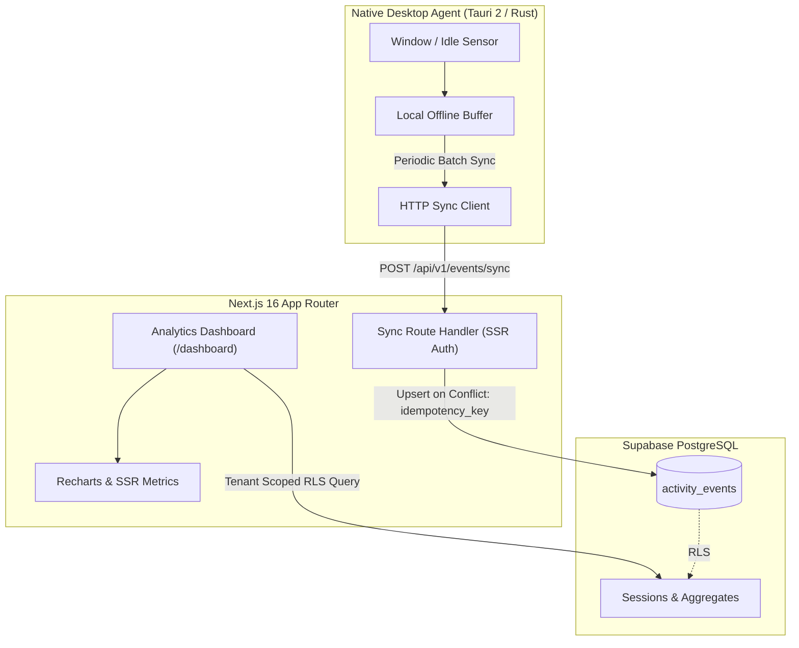
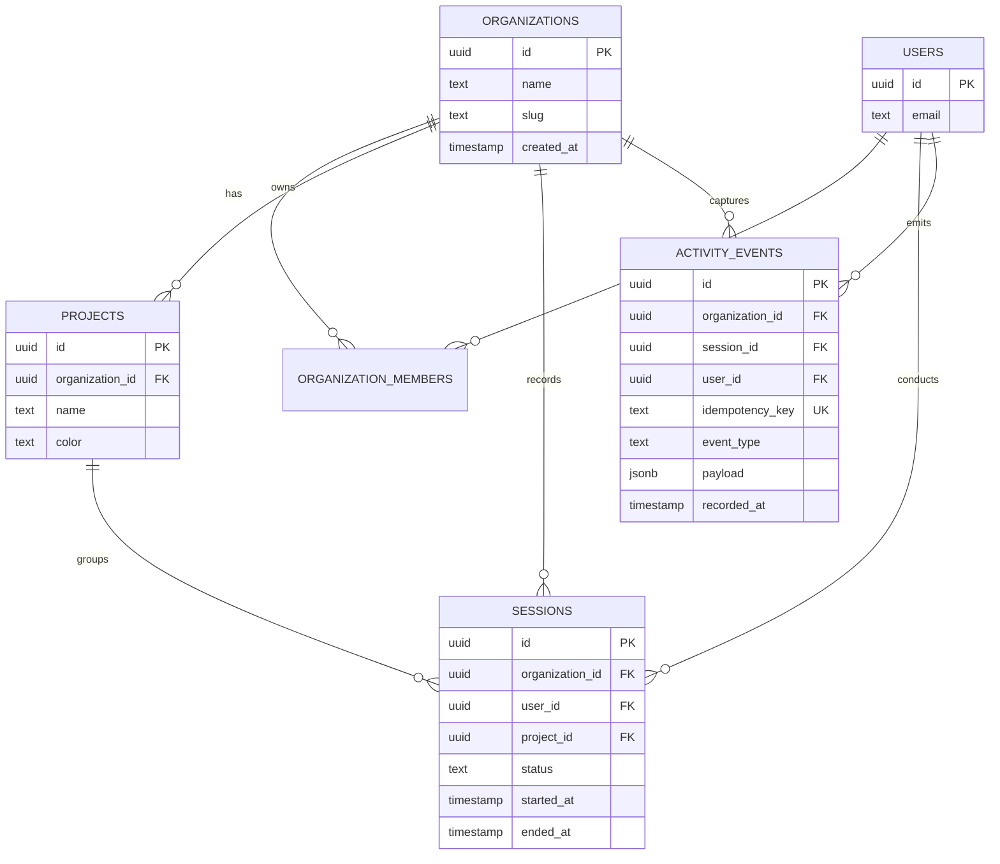

# TrackMe ⏱️

> A privacy-first, multi-tenant engineering time tracking and productivity intelligence platform built with Next.js, Supabase, and Tauri 2.

[](.github/workflows/ci.yml)
[](LICENSE)
[](https://nextjs.org/)
[](https://supabase.com/)
[](https://tauri.app/)

---

## 1. Overview & Vision

Modern engineering teams need transparent time accounting without intrusive surveillance or central data leaks. **TrackMe** bridges high-frequency local desktop telemetry with multi-tenant cloud analytics while keeping user data strictly protected.

- **Privacy-First Ingestion**: Telemetry collects anonymized activity states and window classes without recording keystrokes, screenshots, or sensitive payload data.
- **Enterprise Multi-Tenancy**: Organizations are logically partitioned at the database layer using Postgres Row-Level Security (RLS).
- **Offline Resilient**: Local desktop agents buffer metrics in offline SQLite / memory queues and synchronize via idempotent batch transactions when network connectivity resumes.

---

## 2. Core Engineering Differentiators

### 🛡️ Row-Level Security (RLS) Tenant Isolation
All core entities (`organizations`, `organization_members`, `projects`, `sessions`, `activity_events`) are bound by database-enforced RLS policies. Even in the event of an application-layer bug, an authenticated user cannot read or mutate records outside their active organization membership.

### ⚡ Offline Event Ingestion & Replay
The Linux desktop daemon buffers ticks and application states locally. During intermittent network outages, ticks accumulate without data loss and sync automatically once reconnected.

### 🔁 Idempotent Database Operations
Network retries often cause duplicated metrics. Activity event payloads carry client-generated deterministic SHA-256 / UUID `idempotency_key` attributes. The ingestion API invokes `ON CONFLICT (idempotency_key) DO NOTHING`, ensuring deduplicated state counts.

### 🐧 Cross-Platform Native Agent (Tauri 2 & Rust)
A resource-efficient system-tray background daemon written in Rust/Tauri 2 monitors X11/Wayland idle states and active windows using native Linux APIs with negligible CPU (<0.5%) and RAM (<35MB) overhead.

---

## 3. Tech Stack Summary

| Layer | Technologies |
|---|---|
| **Frontend Web** | Next.js 16 (App Router), React 19, Tailwind CSS v4, Lucide Icons |
| **Component System** | Shadcn UI, Base UI, tw-animate-css |
| **Analytics & Visuals** | Recharts (multi-series activity, idle ratio, category heatmaps) |
| **Backend & Database** | Supabase Postgres, Supabase SSR Auth, Row Level Security (RLS) |
| **Desktop Client** | Tauri 2.0 (Rust backend + Web view client) |
| **Testing & CI/CD** | Vitest, JSDOM, React Testing Library, Playwright, GitHub Actions |

---

## 4. Architecture & Database Entity ERD

### System Flow Diagram



### Database Entity Relationship Diagram (ERD)



---

## 5. Local Setup & Migration Instructions

### Prerequisites
- Node.js 20+
- npm 10+
- Rust & Cargo (only required if building Tauri desktop client)
- Supabase CLI or active Supabase project

### Environment Variables
Copy `.env.local.example` to `.env.local` and provide your credentials:

```bash
cp .env.local.example .env.local
```

Populate the following values:
```env
NEXT_PUBLIC_SUPABASE_URL="https://your-project.supabase.co"
NEXT_PUBLIC_SUPABASE_ANON_KEY="your-anon-key"
```

### Installation & Migrations
1. **Install web dependencies:**
   ```bash
   npm install --legacy-peer-deps
   ```

2. **Apply Supabase migrations:**
   ```bash
   npx supabase db push
   # or execute SQL migration files directly in Supabase SQL editor:
   # 1. supabase/migrations/00001_initial_schema.sql
   # 2. supabase/migrations/00002_add_idempotency_key_to_activity_events.sql
   ```

3. **Run Next.js dev server:**
   ```bash
   npm run dev
   ```
   Open [http://localhost:3000](http://localhost:3000) in your browser.

### Test Execution
- **Run Unit Tests (Vitest):**
  ```bash
  npm test
  # or
  npx vitest run
  ```

- **Run E2E Tests (Playwright):**
  ```bash
  npx playwright test
  ```

- **Build Production Bundle:**
  ```bash
  npm run build
  ```
# TrackMe
